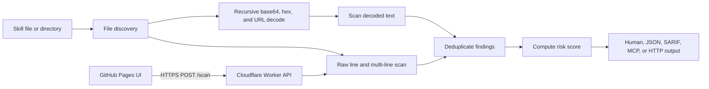
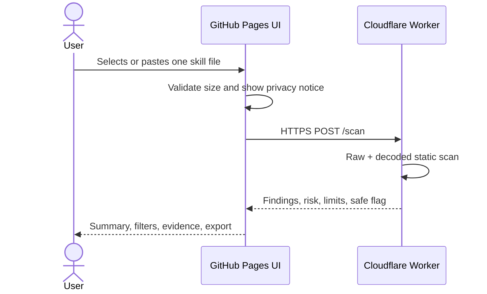

# SkillScan: Project and GitHub Pages UI Guide

This guide explains what SkillScan does today, how its code is organized, how to run and extend it, and what is required to put a web UI on GitHub Pages.

SkillScan is the web application's brand. The underlying scanner's CLI command, configuration filenames, baseline directory, and existing Cloudflare API address retain their legacy identifiers for compatibility; use the literal names shown in the examples below.

> **Short version:** GitHub Pages can host the UI, but it cannot run the Node.js CLI or an HTTP server. The most direct production architecture is a static GitHub Pages frontend that sends one file at a time to the existing Cloudflare Worker API.

## Local Web App

The implemented website entry point is [`../skillscan.html`](../skillscan.html), alongside EASM and linked from Resources > Tools. Its scripts, workspace styles, and icons live in `SkillScan/`. It uses the shared Preemptive Cyber Security navigation and theme, and includes uploads, a paste editor, a live risk dial, sidebar category filters, evidence details, partial-result warnings, and JSON export.

```bash
npm --prefix SkillScan start
npm --prefix SkillScan test
```

Run these commands from the website root. Open the URL printed by the server, normally http://127.0.0.1:4173/skillscan.html. No additional dependencies are needed. The server serves the website root. Scanning still sends content to the Cloudflare API after explicit consent. Deploy the website root to publish this integrated page; the API must allow the deployed origin through CORS.

## 1. What the project is

SkillScan is a static security scanner for AI-agent skill packages. A skill is normally a `SKILL.md` file plus scripts and configuration files that an agent may read or execute. The current compiled rule set contains 151 rules across 15 categories. SkillScan inspects files without executing them and reports patterns associated with:

- prompt injection and model-specific jailbreaks;
- secret collection and data exfiltration;
- command injection and dangerous shell/process execution;
- malicious package installation and supply-chain behavior;
- persistence and privilege escalation;
- destructive or out-of-scope filesystem access;
- suspicious networking and tunnels;
- PowerShell, Docker, and Ruby attack patterns;
- encoded or obfuscated payloads.

The package is written in TypeScript, requires Node.js 18.3 or newer for local use, and has no runtime npm dependencies. TypeScript and Node type definitions are development dependencies.

The underlying scanner provides deterministic, offline-capable static analysis; the current SkillScan web UI uses the cloud API. It does not execute the submitted code, provide a sandbox, perform AST/data-flow analysis, or use an LLM to infer intent. A clean result means no configured pattern matched; it is not proof that a skill is safe.

## 2. Architecture



### Main source areas

| Path | Responsibility |
| --- | --- |
| `src/cli.ts` | CLI parsing, subcommand dispatch, configuration precedence, output, and exit codes |
| `src/scanner.ts` | File discovery, text scanning, decoded-content scanning, deduplication, concurrency, and risk scoring |
| `src/rules.ts` | Combines all built-in rule modules into the effective rule set |
| `src/rules/` | Detection rules grouped by threat family |
| `src/decode.ts` | Recursive base64, hex, and URL decoding |
| `src/config.ts` | Finds and validates `skillsguard.config.json` |
| `src/report.ts` | Human-readable, JSON, statistics, and baseline-diff output |
| `src/sarif.ts` | SARIF 2.1.0 generation for code-scanning systems |
| `src/lib/baseline.ts` | Finding fingerprints and baseline persistence/diffing |
| `src/diff.ts` | Git changed-file and staged-file scans |
| `src/watch.ts` | Filesystem watch mode and finding deltas |
| `src/hook.ts` | Git pre-commit hook installation and removal |
| `src/explorer.ts` | Rule listing and detailed rule inspection |
| `src/setup.ts` | MCP registration in supported client configuration files |
| `src/mcp.ts` | JSON-RPC/stdio MCP server and remote-content handling |
| `src/server.ts` | Loopback-only local HTTP server |
| `src/index.ts` | Public Node.js library exports |
| `worker/src/worker.ts` | Public Cloudflare Worker routes, limits, CORS, and rate limiting |
| `worker/src/scanner.ts` and `worker/src/rules/` | Worker-side copy of scanner and rules |
| `tests/` | Unit and behavior tests |
| `testskills/` | Safe and malicious fixtures plus real-world test data |
| `skill/SKILL.md` | Instructions that teach an AI agent how to use the scanner |

The root scanner and Worker currently duplicate scanner/rule code. Any rule or scanner change must be kept in sync in both trees until a shared browser/Worker-compatible core is introduced.

## 3. How a scan works

### File discovery

The Node scanner accepts one file or recursively walks a directory. It recognizes Markdown/text, shell, PowerShell, Python, JavaScript/TypeScript, JSON/YAML/TOML/config, HTML/XML, Ruby, Dockerfile, Makefile, and Gemfile inputs.

It skips common generated or dependency directories such as `node_modules`, `.git`, `dist`, `build`, coverage output, virtual environments, caches, and `.skillsguard`. Individual files larger than 512 KB are not scanned and generate an informational finding. Directory scans use up to 16 concurrent file operations unless fast-fail mode requires sequential scanning.

### Pattern matching

Each configured rule is tested against individual lines. A five-line sliding window also detects suspicious commands split across continuations. Rules may opt out of pure comment lines or obvious placeholder/example content. Findings in test/fixture/example paths are reduced to `INFO`, except `CRITICAL` findings.

An inline suppression recognized by the ignore helper can silence a specific rule. Configuration can also ignore rules, add custom regex rules, replace built-ins, override severities, exclude path segments, or stop after a finding limit.

### Decode-first analysis

SkillScan extracts candidate base64, hexadecimal, and URL-encoded blobs, keeps mostly printable decoded values, recursively unwraps up to five layers, and limits work to 100 decoded blobs. The decoded text is passed through the same rules. Findings retain `decodedFrom` metadata for forensic context.

### Deduplication and risk

Findings are deduplicated by rule ID, file, and line. If raw and decoded findings collide, the decoded finding is retained because it has more context.

Risk is calculated per severity bucket:

$$
\text{score} = \min\left(100, \sum_s \log_2(n_s + 1)w_s\right)
$$

The weights are `CRITICAL=25`, `HIGH=10`, `MEDIUM=3`, `LOW=1`, and `INFO=0`. Labels are `NONE` at 0, `LOW` through 10, `MEDIUM` through 30, `HIGH` through 60, and `CRITICAL` above 60. The returned score can be fractional.

## 4. Current capabilities

### CLI and library

Build and link the CLI from this project's root directory:

```bash
npm install
npm run build
npm link
skillsguard ./path/to/skill
```

Common scan controls include:

```bash
skillsguard ./skill --json
skillsguard ./skill --sarif
skillsguard ./skill --min-severity HIGH
skillsguard ./skill --max-risk 40
skillsguard ./skill --quiet
skillsguard ./skill --stats
skillsguard ./skill --max-findings 10
skillsguard ./skill --exclude vendor --exclude generated
skillsguard ./skill --severity-override EX-008:CRITICAL
skillsguard ./skill --rule "CUSTOM-001:HIGH:custom:Suspicious pattern:suspicious-pattern"
skillsguard ./skill --rules-only --rule "dangerous-pattern"
```

Exit code `0` means no blocking finding, `1` means findings or a configured threshold failure, and `2` means a usage/configuration error. `--exit-zero` makes reporting non-blocking.

The package also exports `scan`, `scanText`, `findDecodedBlobs`, `computeRiskScore`, the built-in rules, reporting helpers, configuration loading, git-diff scanning, hook/setup helpers, and shared types. The current public entry is Node-oriented and must not be imported directly into a browser bundle.

### Configuration and tuning

The scanner searches upward for `skillsguard.config.json`, stopping at a Git boundary or filesystem root. CLI arguments take precedence. A representative configuration is:

```json
{
  "minSeverity": "HIGH",
  "maxRiskScore": 40,
  "exitZero": false,
  "ignoreRules": ["EX-008"],
  "severityOverrides": {
    "OB-001": "MEDIUM"
  },
  "excludePatterns": ["vendor", "generated"],
  "maxFindings": 50,
  "extraRules": [
    {
      "id": "ORG-001",
      "pattern": "internal_secret_name",
      "severity": "CRITICAL",
      "message": "Organization secret reference"
    }
  ]
}
```

Use `skillsguard rules`, `skillsguard rules RULE-ID`, and rule filters to explore detections. `skillsguard tune RULE-ID --severity HIGH` persists a severity override.

### Developer workflows

- `--watch` rescans after filesystem changes and displays new/resolved findings.
- `--diff [base]` scans files changed relative to a Git ref; `--staged` scans staged files.
- `--save-baseline`, `--diff-baseline`, and `--update-baseline` support gradual adoption through `.skillsguard/baseline.json`.
- `install-hook` creates a pre-commit gate and can preserve an existing hook as a backup.
- `uninstall-hook` removes only hooks marked as scanner-owned and restores a backup when present.
- SARIF output can be consumed by GitHub Code Scanning or another SARIF-compatible system.

### MCP integration

The stdio MCP server exposes tools for scanning one skill and a directory of skills. It can also retrieve supported remote content with size/content-type controls. `skillsguard setup` writes an MCP entry to detected Claude client configuration locations. MCP is a local process integration and cannot run on GitHub Pages.

### HTTP services

There are two HTTP implementations:

1. `skillsguard server` starts a Node server on `127.0.0.1:3000` by default. It accepts raw text or `{ "content", "filename" }` JSON at `POST /scan`. It scans raw text only and returns `filename`, `findings`, and `safe`.
2. The Cloudflare Worker exposes `GET /`, `GET /health`, and `POST /scan`. It scans raw and decoded text, deduplicates findings, calculates risk, sanitizes filenames, adds CORS/security/rate-limit headers, and reports partial-result warnings.

The Worker defaults are 512 KB per request, 10,000 scanned lines, 500 returned findings, and 60 requests per minute per IP. The deployed configuration currently allows all CORS origins.

## 5. What GitHub Pages can and cannot host

GitHub Pages serves static HTML, CSS, JavaScript, images, and other files over HTTPS. It cannot:

- run Node.js, `skillsguard server`, or the CLI;
- access arbitrary local paths or silently walk a user's filesystem;
- spawn Git for diff mode;
- install hooks, watch directories, or write a baseline beside a repository;
- host MCP over stdio;
- keep API secrets safely in frontend JavaScript;
- provide a server-side proxy or rate limiter.

A browser can read files that the user explicitly selects. Modern Chromium browsers support directory selection through `<input type="file" webkitdirectory>`, but this is user-mediated and not identical to Node filesystem access. Baselines/configuration can be uploaded and downloaded or stored in IndexedDB, but that functionality does not exist yet.

## 6. Recommended web architecture

Use GitHub Pages for the static UI and the existing Cloudflare Worker for scanning:



This requires no server on GitHub Pages and works with the current API. It does send submitted content to Cloudflare, so the UI must state that clearly before upload. Do not claim that files remain local in this mode.

### Capability matrix

| Capability | CLI | Pages + Worker | Future in-browser core |
| --- | ---: | ---: | ---: |
| Paste/single-file scan | Yes | Yes | Yes |
| Recursive decoded scan | Yes | Yes | Yes |
| Risk score | Yes | Yes | Yes |
| Directory scan | Yes | One request per selected file, if UI implements it | Yes, for user-selected files |
| Custom rules/config | Yes | No, API has no options contract | Possible after core extraction |
| Baseline workflow | Yes | No | Possible with upload/download or IndexedDB |
| Git diff/staged scan | Yes | No | Not without a Git implementation/repository permission |
| Watch mode | Yes | No | Limited to files reselected by the user |
| Pre-commit hook | Yes | No | No |
| MCP | Yes | No | No |
| Content stays on device | Yes | No | Yes |

## 7. Build the GitHub Pages UI

The static frontend is implemented in `../skillscan.html` with supporting files in `SkillScan/`. Its main capabilities are:

- a paste editor and drag/drop or file picker;
- accepted-file and 512 KB size validation before upload;
- a prominent disclosure that content is sent to the Worker;
- loading, empty, success, unsafe, partial-result, rate-limit, and network-error states;
- a risk summary and severity/category counts;
- findings with rule ID, severity, category, filename, line, evidence, and decoded-source context;
- severity/category filtering and keyboard-accessible controls;
- JSON export of the API response;
- no HTML rendering of evidence; display it as text to avoid injection;
- no third-party analytics receiving uploaded content or finding evidence.

This implementation uses root-level `skillscan.html`, shared website styles and navigation, and `app.js`, `scan-client.js`, and `preemptive.css` in `SkillScan/`, with local assets and a Node static development server. A framework is optional. If using Vite or another bundler in the future, configure its base path for the repository name and deploy only the build output.

### Minimal API client

```js
const API_URL = "https://skillsguard.apiskillsguard.workers.dev/scan";

export async function scanFile(file, signal) {
  if (file.size > 512 * 1024) {
    throw new Error("The Cloud API accepts files up to 512 KB.");
  }

  const response = await fetch(API_URL, {
    method: "POST",
    headers: { "Content-Type": "application/json" },
    body: JSON.stringify({
      filename: file.name,
      content: await file.text()
    }),
    signal
  });

  const result = await response.json().catch(() => ({}));
  if (!response.ok) {
    const error = new Error(result.error || `Scan failed (${response.status})`);
    error.status = response.status;
    error.retryAfter = response.headers.get("Retry-After");
    throw error;
  }

  return result;
}
```

The UI should treat `warning`, `findingsTruncated`, and `totalFindings` as important state, not decoration. A response can be valid but incomplete. Use `safe === true` only as “no finding was detected in the scanned content,” never as a security guarantee.

### Expected Worker response

```json
{
  "filename": "SKILL.md",
  "filesScanned": 1,
  "findings": [
    {
      "ruleId": "PI-001",
      "category": "prompt-injection",
      "severity": "CRITICAL",
      "message": "...",
      "file": "SKILL.md",
      "line": 12,
      "evidence": "...",
      "pattern": "...",
      "decodedFrom": "base64:..."
    }
  ],
  "riskScore": {
    "score": 25,
    "label": "MEDIUM"
  },
  "safe": false,
  "durationMs": 4
}
```

### Multiple files or directories

The API scans one file per request. A UI may let users select several files and submit them individually, with bounded concurrency of two to four requests. Do not concatenate files: that corrupts filenames/line numbers and can create cross-file multi-line matches.

Respect HTTP `429` and `Retry-After`. At the default limit, bulk scans can exceed 60 requests per minute per public IP. Aggregate client results only after preserving each response's filename and partial-result flags. For large repositories, direct users to the CLI rather than attempting to reproduce the complete CLI workflow in Pages.

## 8. Deploy the UI to GitHub Pages

For this integrated website, deploy the repository root so `skillscan.html`, `SkillScan/`, `assets/`, and `pages/` keep their relative paths. GitHub Pages branch deployment can publish the root directly; no scanner-specific build or workflow is required. The alternatives below describe standalone layouts, not this website's current deployment.

### Option A: deploy a `docs/` directory

This is the simplest setup for plain HTML/CSS/JavaScript.

1. Add the static app under `docs/` with `docs/index.html` as its entry point.
2. Commit and push the files to the default branch.
3. Open repository **Settings > Pages**.
4. Under **Build and deployment**, choose **Deploy from a branch**.
5. Choose the default branch and `/docs`, then save.
6. Open `https://<owner>.github.io/<repository>/` after deployment completes.

Use relative asset URLs such as `./app.js` and `./styles.css`. Absolute URLs such as `/app.js` point at the account-level site root and commonly break project Pages sites.

### Option B: deploy a built frontend with GitHub Actions

For Vite/React or another build system, publish the generated directory with the official Pages actions. Configure the app's production base path as `/<repository>/` unless it is deployed at an account root or custom domain.

Create `.github/workflows/pages.yml`:

```yaml
name: Deploy web UI to Pages

on:
  push:
    branches: [main]
    paths:
      - "web/**"
      - ".github/workflows/pages.yml"
  workflow_dispatch:

permissions:
  contents: read
  pages: write
  id-token: write

concurrency:
  group: pages
  cancel-in-progress: true

jobs:
  deploy:
    environment:
      name: github-pages
      url: ${{ steps.deployment.outputs.page_url }}
    runs-on: ubuntu-latest
    steps:
      - uses: actions/checkout@v4
      - uses: actions/setup-node@v4
        with:
          node-version: 20
          cache: npm
      - run: npm ci
      - run: npm run build:web
      - uses: actions/configure-pages@v5
      - uses: actions/upload-pages-artifact@v3
        with:
          path: web/dist
      - id: deployment
        uses: actions/deploy-pages@v4
```

The example assumes a future `build:web` script and `web/dist` output; neither exists yet. Add them when selecting the frontend toolchain. Pin action commit SHAs instead of mutable tags if the repository's supply-chain policy requires it.

In **Settings > Pages**, set the source to **GitHub Actions**. Repository Actions must have Pages deployment permission.

### Custom domain and CORS

GitHub Pages provides HTTPS for its default domain and supported custom domains. Keep the UI and API on HTTPS.

The Worker currently uses `CORS_ALLOWED_ORIGINS="*"`. For a production-owned UI, restrict it in `worker/wrangler.toml`, for example:

```toml
CORS_ALLOWED_ORIGINS = "https://your-account.github.io,https://skillscan.example.com"
```

Redeploy the Worker after changing configuration. Test both the Pages origin and any custom domain. The current origin resolver returns the first configured origin for a disallowed requester rather than omitting CORS entirely; browsers still block that requester, but explicitly rejecting disallowed origins would be clearer hardening.

## 9. Cloudflare Worker requirements

The public endpoint is already referenced by the project. To own or redeploy it, the project needs:

- a Cloudflare account with Workers and Durable Objects support;
- Wrangler available through a pinned development dependency or `npx wrangler`;
- a Durable Object binding named `RATE_LIMITER` and its migration;
- the environment variables in `worker/wrangler.toml`;
- a deployment command and Cloudflare authentication, preferably through an API token stored only in repository Actions secrets;
- API health, CORS, payload-limit, rate-limit, and scanner parity tests.

The `worker/` directory currently has no separate `package.json`, and the root package does not declare Wrangler or Cloudflare Worker type packages. Before documenting a reproducible Worker build, add a pinned toolchain and a script such as `deploy:worker`; do not rely on a globally installed CLI.

Do not put a Cloudflare API token, GitHub token, or other secret in Pages JavaScript. Browser code is public. The scan API currently requires no client secret.

## 10. Privacy-first alternative: scan entirely in the browser

A fully static scanner would keep selected files on the user's device and remove API rate limits. It is feasible, but the current root package is not directly browser-compatible:

- `src/scanner.ts` imports `node:fs/promises` and `node:path`;
- `src/decode.ts` uses Node's `Buffer`;
- the public `src/index.ts` exports Node-only config, Git, setup, hook, and reporting modules;
- the Worker scanner tree also retains Node filesystem/path imports even though `/scan` only calls its text-scanning functions;
- CLI, MCP, hooks, watch mode, git diff, and local HTTP serving fundamentally remain Node-only.

The maintainable refactor is:

```text
src/
  core/
    types.ts
    rules.ts
    rules/
    ignore.ts
    decode.ts          # TextDecoder/Uint8Array or a narrow adapter
    scan-text.ts       # No fs, path, process, Buffer, or Node imports
  node/
    scan-files.ts
    config.ts
    diff.ts
    hook.ts
    mcp.ts
    server.ts
  browser/
    scan-files.ts      # File/FileList input supplied by the user
```

Both the Node scanner and Worker should import the same core. Add browser tests that run the production bundle in an actual browser, plus parity tests asserting identical findings and risk scores for the same text in Node, Worker, and browser builds.

For directory upload, use `webkitdirectory` as an enhancement and retain multiple-file selection as a fallback. Enforce limits on file count, total bytes, lines, decoded blobs, and findings so a malicious upload cannot freeze the tab. Consider a Web Worker for scanning to keep the UI responsive.

## 11. Why the local HTTP server is not the Pages backend

The local server binds only to `127.0.0.1`, which is appropriate for local security. However, the current implementation does not send CORS headers, and an HTTPS GitHub Pages page calling `http://127.0.0.1:3000` is subject to mixed-content and private-network browser restrictions. It also scans only raw text, unlike the Cloudflare Worker and CLI decode-first flow.

Therefore, do not present “start `skillsguard server` and connect from Pages” as a supported production mode without a deliberate local bridge design: HTTPS, explicit origin allowlisting, preflight handling, CSRF/private-network protections, decoded scanning, clear user consent, and tests across target browsers.

## 12. Security requirements for the web UI

Because the UI displays attacker-controlled skill content, apply these rules:

1. Render filenames, messages, evidence, and decoded content with `textContent` or framework text interpolation. Never pass them to `innerHTML`.
2. Add a restrictive Content Security Policy. If GitHub Pages cannot supply the desired response header, use a CSP `<meta>` tag and avoid inline scripts/styles.
3. Permit network access only to the Worker origin with `connect-src`.
4. Do not fetch URLs found inside uploaded skills or make evidence clickable by default.
5. Do not execute, preview as HTML, dynamically import, or syntax-highlight through an unsafe HTML path.
6. Cap file count, request concurrency, local rendering count, and evidence length.
7. Preserve Worker truncation warnings and never label a partial scan “safe.”
8. Make the upload-to-Cloudflare behavior explicit and document retention/logging policy.
9. Keep dependencies minimal, lock versions, review lockfile changes, and use Dependabot or equivalent monitoring.
10. Treat API availability and rate limiting as normal UI states, not unexpected exceptions.

## 13. Validation checklist

### Project checks

```bash
npm install
npm run build
npm run build:test
npm run test:unit
npm run test:fixtures
```

The combined `npm test` runs the build, unit tests, and fixture tests.

### UI checks

- A known safe fixture shows no findings without claiming guaranteed safety.
- Each malicious fixture produces the expected severity, rule details, and evidence.
- Base64/hex/URL-obfuscated fixtures produce `decodedFrom` findings.
- Empty, oversized, over-10,000-line, malformed, and non-text inputs are handled clearly.
- HTTP 400, 413, 429, 500, offline, timeout, and abort states are visible and recoverable.
- Truncated inputs/findings cannot display a clean or complete-scan state.
- Evidence containing HTML/script text is displayed inertly.
- Keyboard navigation, focus states, labels, contrast, and mobile layout work.
- Asset paths work at `/<repository>/`, not only at `/`.
- The deployed Pages origin passes Worker CORS preflight and `POST /scan`.
- No secrets or uploaded file contents appear in console logs, analytics, URLs, or local storage unless explicitly designed and disclosed.

### Deployment smoke test

```bash
curl -i https://skillsguard.apiskillsguard.workers.dev/health
curl -i -X OPTIONS \
  -H "Origin: https://<owner>.github.io" \
  -H "Access-Control-Request-Method: POST" \
  https://skillsguard.apiskillsguard.workers.dev/scan
curl -s --data-binary @skill/SKILL.md \
  "https://skillsguard.apiskillsguard.workers.dev/scan?filename=SKILL.md"
```

## 14. Suggested delivery plan

### Phase 1: useful UI with current API

1. Create a dependency-light static app under `docs/` or a dedicated `web/` directory.
2. Implement paste and single-file scanning against the Worker.
3. Add complete result, warning, rate-limit, and error states.
4. Add fixture-driven browser tests and accessibility checks.
5. Deploy to Pages and restrict Worker CORS to the production origins.

### Phase 2: multi-file experience

1. Add multiple-file and optional directory selection.
2. Submit files separately with bounded concurrency and rate-limit backoff.
3. Aggregate results without losing per-file metadata or warnings.
4. Direct oversized/bulk repository scans to the CLI.

### Phase 3: private client-side scanning

1. Extract one environment-neutral scanner core.
2. Replace `Buffer` in core decoding with browser-compatible primitives or adapters.
3. Make Node and Worker import the shared core to eliminate rule drift.
4. Run scanning in a browser Web Worker.
5. Add cross-runtime parity and performance tests.

## 15. Important current caveats

- Rules are regex-based and may produce false positives or miss semantically malicious behavior.
- The CLI is the only current mode that scans a directory as one operation and supports config, baselines, Git, watch mode, hooks, and full local privacy.
- The Worker API accepts one file per request and does not expose custom rules, ignore lists, or severity overrides.
- The local HTTP server's behavior and response schema differ from the Worker.
- Scanner/rule code is duplicated under `src/` and `worker/src/`, creating drift risk.
- Some project metadata uses “100+ rules” while the README describes 151 rules; derive displayed counts from the compiled rule set when possible instead of hard-coding them in the UI.
- Documentation and metadata examples should be checked against the actual `ScanResult`/Worker schema before clients depend on them.
- GitHub Pages is public static hosting. Repository visibility and plan determine Pages availability, but deployed frontend assets must always be treated as public.

## 16. Recommended decision

Start with **GitHub Pages UI + Cloudflare Worker API**. It matches the code that exists, requires no backend process on Pages, supports decoded scanning and risk scores, and can be deployed incrementally.

Use the CLI for repository-scale, confidential, configuration-aware, baseline, Git, watch, hook, and MCP workflows. Plan a shared browser-compatible core only when keeping submitted content on-device or eliminating the hosted API is a product requirement.